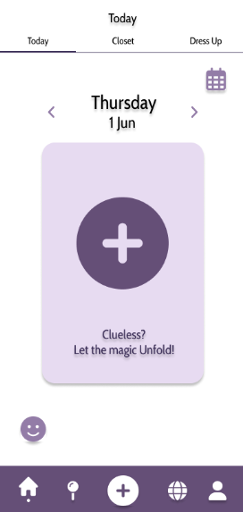
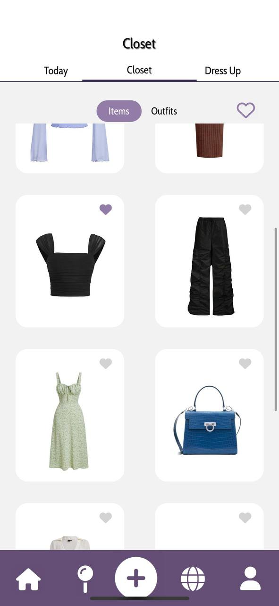
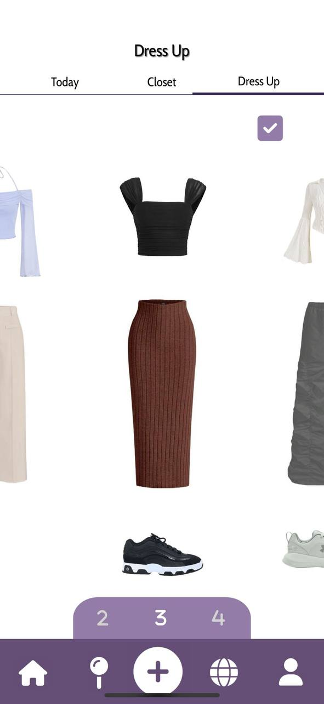
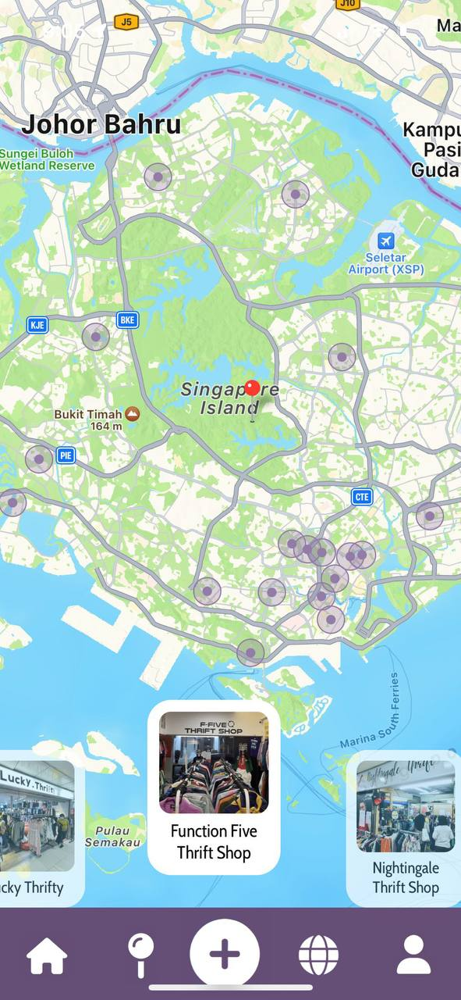
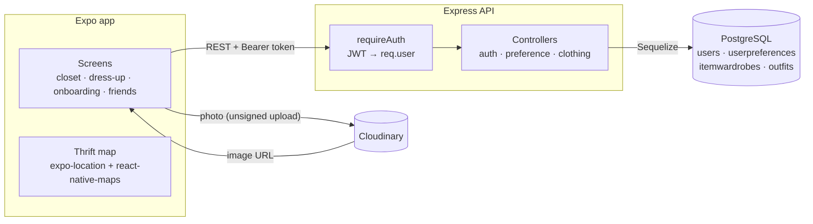

<p align="center"></p>

# Unfold

[](https://github.com/maiyasaliha/Unfold2.0/actions/workflows/ci.yml)
[](LICENSE)

**Clueless about what to wear? Let the magic Unfold.**

Unfold is your closet in your pocket. Snap your clothes, mix them into outfits, and when something's had its day, find a thrift shop or donation point nearby in Singapore.

Built for NUS Orbital 2023 as a team of two, where it reached Apollo 11, the second-highest level. Tested by two fellow groups and our mentor.

Orbital teammate: [Nivetha Sekar](https://github.com/nivviee)

<table>
  <tr>
    <td align="center"><br><sub>Today</sub></td>
    <td align="center"><br><sub>Closet</sub></td>
    <td align="center"><br><sub>Dress up</sub></td>
    <td align="center"><br><sub>Thrift map</sub></td>
  </tr>
</table>

**[Watch the demo video](https://drive.google.com/file/d/1E_T5QYC_geEYQb4HQg5NNDS9FgcU1E6y/view?usp=sharing)**

## What you can do

- **Fill your closet.** Add clothes with a photo and tag them with type, colour, material, season and more
- **Dress up.** Swipe through your clothes to put together 2, 3 or 4 piece outfits: a one-piece and shoes, a top, bottom and shoes, or all that plus accessories
- **Show your style.** Set up your profile when you sign up, with body shape, face shape, skin undertone and your vibe, from Y2K to coquette
- **Peek at friends' closets.** Search for friends and browse their wardrobes
- **Give clothes a second life.** Find 23 thrift shops, Refash stores and donation points on the map

## What I did

| Area | Work |
|---|---|
| Mobile app | All 28 screens in React Native (Expo): authentication, 9-step onboarding, closet with category filters and favourites, 2/3/4-piece outfit builder, friend search and wardrobe view, and a geolocated thrift map with a synced shop carousel |
| API | Express REST API with bcrypt password hashing and JWT authentication; endpoints for preferences, wardrobe items and outfits |
| Database | Relational schema in Sequelize (users, preferences, wardrobe items, outfits), originally on MySQL |
| Media | Image uploads to Cloudinary, replacing base64 storage in the database |
| Deployment (2023) | API on Render and MySQL on Hostinger so testers could use the app |
| Cleanup (2026) | Token-derived authorization on every route, 30 API tests, GitHub Actions CI, PostgreSQL with Docker, secrets removed from code and git history. Done with my own Claude agent skills (repo-audit → repo-fix → repo-showcase); every change reviewed by me. |

## Tech stack

React Native with Expo for the app, Node and Express for the API, Sequelize with PostgreSQL for the database, JWT for login and Cloudinary for the photos.

## How it works

The app talks to the API and sends your login token with every request, and the API figures out who you are from that token. Photos don't go through the API at all, the app uploads them straight to Cloudinary and just saves the link. The map is all done inside the app.



## Getting started

Requires Node 22, Docker (or any Postgres 16), and the Expo Go app on your phone.

```bash
# 1. Database
docker compose up -d

# 2. API (http://localhost:5000)
cd server
cp .env.example .env        # set JWT_SECRET to a long random string
npm install
npm start

# 3. App
cd ../mobile
npm install --legacy-peer-deps
npx expo start              # scan the QR code with Expo Go
```

To run on a phone or enable photo uploads, put your own settings in `mobile/app.local.json`. That file is git-ignored.

```bash
cp app.local.example.json app.local.json
```

- **`apiUrl`**: your computer's LAN address, e.g. `http://192.168.1.10:5000`.
- **`cloudinaryCloudName`** and **`cloudinaryUploadPreset`**: your Cloudinary account and an [unsigned upload preset](https://cloudinary.com/documentation/upload_presets). Everything except adding photos works without them.

**Tests:** run `npm test` in `server/`. They use in-memory SQLite. To run against Postgres instead, set `TEST_DATABASE_URL=postgres://…`. CI runs both.

## Why I did things this way

I first stored photos in the database as base64. Later I switched to uploading them straight to Cloudinary, so the database only keeps the URL. The catch is the upload preset is unsigned, so anyone who has it could upload to the account.

The server doesn't trust a user ID coming from the app. For your own stuff it uses the ID from your token. Friends' wardrobes are open to anyone who's logged in, since that's the whole point of that feature.

Every onboarding step saves on its own, so if you quit halfway or redo it, nothing gets lost or doubled.

## What's next

More features are planned and will be added in the future. A release on Google Play and the App Store is also planned.

## License

[MIT](LICENSE)
